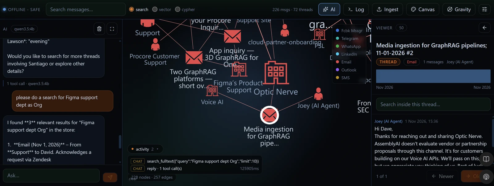
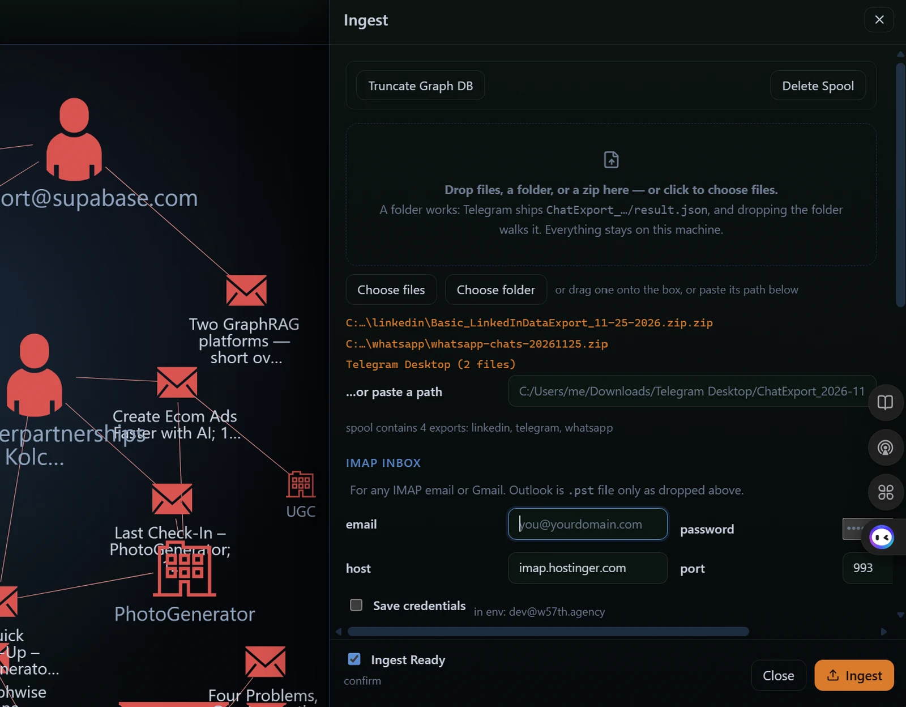

# Social Comms GraphRAG

**relate-comms-graph** — your own message archives, across seven platforms, as one local,
privacy-scrubbed graph.

> Working prototype. Seven adapters, live IMAP email, identity resolution across platforms,
> a scrub gate that runs *before* the write, a local-only UI, an AI chat, and an MCP server
> so your IDE's agent can read it. **Nothing leaves the machine.**

---

## What it handles

| Platform | Route | Grade |
|---|---|---|
| **Telegram** | Desktop export → `result.json` | **A** — documented schema |
| **WhatsApp** | per-chat `.txt` / `.zip`, **and** the extension's HTML | B — **no bulk export**; use a recommended 3rd-party exporter |
| **Facebook Messenger** | *Download your information* → HTML archive | B/C — slow, no API |
| **LinkedIn** | *Basic* archive → `messages.csv` | **A** data |
| **Email (any IMAP)** | live, read-only — Gmail, Hostinger, cPanel, Yahoo, iCloud, Zoho… | **A** |
| **Outlook** | `.pst` export | **A** |
| **SMS (Android)** | *SMS Backup & Restore* XML or `.xml.zip` | **A** — **no bulk export**; use a recommended 3rd-party app |

Seven legs, one store. Ingest any subset, in any order, any number of times — every write is
a `MERGE` on a stable key, so a re-ingest updates rather than duplicates.

**WhatsApp and Android SMS have no official bulk export.** Both are handled by well-known
third-party apps that write the same shapes this reads — the per-chat `.txt`/`.zip` for
WhatsApp, and *SMS Backup & Restore*'s XML for SMS. [`archive_docs/MssgDownloadInstructs.md`](archive_docs/MssgDownloadInstructs.md)
names them.

**Outlook is its own platform, not a variant of Email.** A `.pst` is a file exported at a
point in time; IMAP is a live mailbox. Different provenance, different keys, and merging them
would make "where did this come from" unanswerable.

---

## Seven sources, one graph

Your personal or business comms become **graph nodes** — seven platforms folded into one
walkable structure:

| Node | What it is |
|---|---|
| **Thread** | one conversation |
| **Correspondent** | the other party — folded across platforms by name, phone and email |
| **Place** | a location named in a message body |
| **Organization** | a company named in a message body |
| **Product** | a product named in a message body |
| **Message** | one message |
| **Attachment** | a file a message mentions (metadata only — bytes are never read) |



**Three ways to use it:**

- **The UI** — search and traverse. Three search modes (BM25, semantic, raw Cypher), a
  click-through viewer, and a canvas where a merged node draws a grey glyph and an orange
  halo: the visual claim that two spellings are one person.
- **A local AI chat** — a model on your own machine answers by calling the toolset. Every
  answer comes from a tool call, and the trace of what it asked is shown beside the reply.
- **MCP** — your IDE's agent (Zed, Claude Code, anything that speaks MCP) reads the same
  graph through the same 19 tools, behind **two keys**: a read key and a write key.

---

## The problem

Your messages already *are* a graph: sender → message → thread → reply. That structure is
explicit, not inferred — it is sitting in the export files. But it is shredded across seven
apps, so nobody can answer:

> **"Who did I talk to about the travel to Madrid on more than one platform, and when did it
> stop?"** — or *the Meta Dev Group*, or *a Lexus RX 350*.

The answer exists in your data today and is invisible. Every platform shows you one silo.
None of them can tell you that the person you emailed in March is the same person you were
messaging on Telegram in June, or that a thread went quiet the week after a deal closed.

This makes that visible — as one graph you can walk, search, and question, on your own disk.

---

## Privacy — the whole point

These are the most sensitive files a person owns. Three things follow from that:

- **Everything is local.** No cloud, no telemetry, no outbound call except a loopback Ollama
  on `127.0.0.1:11434`. The store is one file on your disk.
- **The scrub gate runs before the write, not after.** Phone numbers, addresses and card
  numbers are replaced with stable aliases (`PHONE-1`) *before* a row reaches the graph. The
  alias map is memory-only by default — it is a re-identification key, so it is not persisted.
- **Refusals are visible.** Nothing is silently dropped. Unknown message types are counted,
  unrecognised files are reported and kept, and every ingest ends with a verdict per file.

The MCP server is the one feature that lets *another* agent read this store, so it is gated by
two keys and refuses to start without one.

---

## Why a graph, and why Relate

| | |
|---|---|
| **Native edges** | `from` / `to` / `reply_to` / `thread` are data fields, not LLM guesses. Most "documents → graph" tools infer structure; here it is given. |
| **Identity resolution** | The same person appears on three platforms as three Correspondents. Folding them is a real problem, and the demo's money shot. |
| **Cross-platform queries** | "Who did I talk to about the travel to Madrid on more than one platform" is a two-hop traversal, not a join across seven tables. |

**[Relate](https://relate.neo4j.com/)** is Neo4j's embedded graph engine — the reason this
runs with no server at all:

- **One file, no port, no Bolt.** `relate.connect("store/graph.rl")` takes a filesystem path.
  There is nothing to install, nothing to start, nothing listening.
- **Cypher 25**, the real dialect — `MATCH`, `UNWIND`, `MERGE`, `CALL {}`, subqueries.
- **Native vector and fulltext indexes.** `CREATE VECTOR INDEX` for semantic search,
  `CREATE FULLTEXT INDEX` for BM25. Both are used here.
- **~7,000 messages/second** on batched `UNWIND` writes; ~1,500 bytes per message on disk.

**The data model is semi-portable.** The store holds facts, not summaries —
`(message)-[:IN]->(thread)` and `(message)-[:MENTIONS]->(entity)`. "This thread is about the
Meta Dev Group" is computed at read time, not stored. That is the triple model any graph
engine accepts, so the *data* would move to Neo4j, Memgraph or Kùzu unchanged. The **writer**
would not: it is Cypher 25 against Relate's embedded API, so a port means re-writing the
`writer.py` layer, not just pointing at a different server.

> **Honest limitation:** Relate is append-only and has no compaction. Deleting a property
> frees no disk. Reclaiming space means rewriting the store into a fresh `.rl` — which this
> app does, at 64.7 MB → 3.6 MB in 1.9 s.

---

## Setup

Requires **Python 3.11+**. Node 22+ only if you change the UI — `dist/app.js` is committed,
so a clone runs without npm.

```bash
pip install -e ".[resolve,app]"
```

**Run it:**

```bash
python -m app          # http://127.0.0.1:8100
start.bat              # Windows: opens the browser and the server
```

Port **8100**, not 8000 — 8000 is held by another app on this machine.

**Optional, for the AI chat:** install [Ollama](https://ollama.com) and pull a model.

```bash
ollama pull qwen3.5:4b
```

**To change the model**, edit one line in [`relate_comms/models.py`](relate_comms/models.py):

```python
DEFAULT_MODEL = "qwen3.5:4b"   # or "lfm2.5:8b", or anything you have pulled
```

---

## How to run it

**1. Get your exports.** No platform offers an API for your own history, and that is
deliberate on their part. [`archive_docs/MssgDownloadInstructs.md`](archive_docs/MssgDownloadInstructs.md)
has the click-by-click for every platform, including the traps — Gmail needs an App Password,
Meta's download link expires in four days, LinkedIn's *Basic* archive is enough.

> **A savvy architect can automate this.** Most platforms email a download link on request,
> and several can be scripted — a cron job that requests the export, polls for the link, and
> drops the file into `spool/real/` turns this into a weekly refresh. The app does not do that
> for you; it only reads what lands in the spool.

**2. Drop it in.** Press **Ingest** in the title bar and drag the file or folder onto the drop
zone. Files are **copied** into `spool/real/`, never moved — your download is untouched.



**Email is the one live source.** Gmail and any IMAP mailbox are read directly — no file to
download. Enter the address, password, host and port in the Ingest modal; the credentials are
written to `.env` **only after the ingest succeeds**, so a wrong password leaves nothing
behind. Outlook is the exception: Microsoft killed basic auth, so use the `.pst` export.

**3. Re-ingest weekly.** `ingest(delta=True)` is the default: it reads `max(ts_utc)` per
platform from the store and drops every parsed message at or before it, **before** the write
and before extraction. Measured on a realistic weekly case — 10,000 stored + 500 new:

| Run | Time |
|---|---|
| full re-process | 25.7 s |
| delta | 2.6 s |

So the loop is: export again, drop it in, ingest. Only the new week is parsed.

**To try that loop without real exports**, `sample_writer` can extend a world's clock:
set `END` in [`sample_writer/config.py`](sample_writer/config.py) to a past date, build and
ingest, move `END` forward, run `python -m sample_writer append`, and ingest again — the
second run should report most messages dropped as already stored.

---

## For developers and AI agents

| Directory | What is in it |
|---|---|
| [`tests/`](tests/) | The suite (`pytest tests -q`), the committed fixtures, and `tests/README.md` — the payloads and how to wire a new export format. |
| [`tools/`](tools/) | Benchmarks and probes, not app code: `bench_scale.py`, `bench_ollama.py`, `compare_models.py`, `verify_relate.py`, and `ai_visual_graph_tool/` (the headless fcose measurement harness). |
| [`sample_writer/`](sample_writer/) | The world generator. Every knob lives in [`config.py`](sample_writer/config.py) — `END` (the clock), `AVG_THREADS_PER_PLATFORM`, `BIG_THREAD_*`, `BODY_ENTITY_SHARE`, `SPAM_GROUPS`, `APPEND_*`. |
| [`scripts/`](scripts/) | `vendor.mjs` (re-copy Cytoscape + fcose), `build_entity_icons.py`. |

**Nothing in `tools/` is imported by the app.** It is measurement and one-off probes, kept
so a number in the docs can be re-derived rather than trusted.

---

## The toolset — one registry, three surfaces

Every capability is a plain function in `relate_comms/tools.py`. Three surfaces bind the same
functions and differ only in policy:

```
relate_comms/tools.py   REGISTRY — 19 tools
        |
        +-- app/routers/*.py     the UI's HTTP routes
        +-- app/routers/chat.py  the AI chat: 6 tools + write toggle
        +-- app/mcp/server.py    MCP: all 19 + two keys + a path rule
```

**19 tools**, by access:

| Access | Tools |
|---|---|
| **READ** | `graph_slice` `thread_arc` `search_fulltext` `search_vector` `search_messages` `message_view` `types_present` `evidence_counts` `embed_status` `screen_body` `run_cypher` `preview_ingest` `verify_ingest` |
| **WRITE** | `embed_messages` `ingest` |
| **DESTRUCTIVE** | `flush_embeddings` `truncate_store` `prune_spool` `delete_spool` |

**Search has three modes, and they are different promises:**

- **`fulltext`** — BM25 over bodies, ranked and indexed. Word matching, not substring.
- **`vector`** — semantic. Needs an opt-in embed pass; "money I owe someone" finds
  *"been flat out with the remittance"*.
- **`cypher`** — whatever you type, refused if it would write.

**Both search modes also match names.** A person's name is in no message body, so
`_name_matches()` substring-matches `Correspondent.display_name` and returns thread rows.
Without it, typing a correspondent's name found nothing.

### MCP — your IDE's agent

`python -m app.mcp` speaks MCP over stdio, so Zed, Claude Code, or any MCP client can read the
graph. **Two keys** live in `store/profile/mcp.json`:

| Key | Grants |
|---|---|
| `read_key` | 16 tools — read only |
| `write_key` | 21 tools — read + write |

```json
{ "command": "python", "args": ["-m", "app.mcp"],
  "env": { "RELATE_MCP_KEY": "r_…" } }
```

No key, or a wrong one, refuses to start. `ingest` is bounded to paths inside the repo, and
the mailbox credentials are used inside the process — never returned in a response, a tool
argument, or the activity trace. The title bar shows a yellow pulsing **MCP being accessed**
badge while a client is connected.

---

## The sample world — `sample_writer`

**No real exports?** `sample_writer` manufactures a whole believable batch — seven platforms,
every shape the app has a switch for, with the awkward corners a real export contains: threads
the owner never spoke in, spam groups, placeholder senders, off-by-one boundaries, and the
same entity spelled five ways.

```bash
python -m sample_writer              # fake downloads -> sample_writer/out/
python -m sample_writer --seed 5     # wipe & write, seed 5
python -m sample_writer append       # same world, later clock (delta testing)
python -m sample_writer clean        # wipe out/
```

Then drop `sample_writer/out/` onto the Ingest drop zone. `ingest` cannot tell it from a real
download — that is the point.

**Every knob is in [`sample_writer/config.py`](sample_writer/config.py):**

| Knob | What it controls |
|---|---|
| `START` / `END` | the world's clock. **`END` is the one to move** for delta testing |
| `AVG_THREADS_PER_PLATFORM` | world size (each platform rolls ±`THREADS_JITTER`) |
| `BIG_THREAD_COUNT` / `BIG_THREAD_RANGE` / `BIG_THREAD_LOW_WEIGHT` | how many long-running threads, how long, how strongly the short end is favoured |
| `BODY_ENTITY_SHARE` | how often each body kind is named (`org` 1.0, `place` 0.7, `product` 1.6) |
| `SPAM_GROUPS` | how many spam groups the world contains |
| `APPEND_THREAD_SHARE` / `APPEND_NEW_THREAD_SHARE` / `APPEND_MESSAGES` | what `append` adds |

`python -m sample_writer knobs` prints every knob and its current value.

**The delta cycle, end to end:**

1. Set `END` in `config.py` to a date in the past (e.g. a week ago).
2. `python -m sample_writer --seed 8` — build, then ingest that.
3. Set `END` back to now.
4. `python -m sample_writer append` — same world, one more week.
5. Ingest again. The report should show most messages **dropped as already stored** and only
the new week written.

Measured on seed 5, `END` 2025-10-01 → 2026-11-01: run 1 wrote 3,049 messages, run 2 wrote
**146** and dropped 2,749 as already stored.

**It is a substantial piece of work in its own right** — a world generator with a cast, a
thread planner, per-platform writers, and three independent fuzz axes. It could be its own
repo, and it is the reason this one can be demoed without anyone's real history.

---

## Status

Working prototype. `pytest tests -q` → **587 passed, 10 skipped, 1 known failure** (a `canon`
camelCase split, pre-existing).

**Built:** seven adapters + live IMAP, parallel parse → resolve → scrub → serialised write →
verify → prune, body-entity extraction (Place / Organization / Product), delta ingest, BM25 +
vector search, the job registry, the MCP surface, the AI chat, and the UI.

**Not built:** multi-mailbox support (one mailbox at a time — the key carries no mailbox, so
two would silently merge), non-English extraction, and a generated knowledge base to replace
the Log modal.

## Docs

| Doc | What is in it |
|---|---|
| [`TECHREADME.md`](TECHREADME.md) | the pipeline, the modules, the invariants — written for an AI |
| [`SCHEMA.md`](SCHEMA.md) | the store's data model and the 19-tool registry |
| [`UIREADME.md`](UIREADME.md) | the UI app, and every renderer trap |
| [`HANDOVER.md`](HANDOVER.md) | what is next, and what just landed |
| [`archive_docs/MssgDownloadInstructs.md`](archive_docs/MssgDownloadInstructs.md) | how to get each platform's export |
| [`archive_docs/Ollama.md`](archive_docs/Ollama.md) | local model setup on Windows |
| [`sample_writer/README.md`](sample_writer/README.md) | the generator — every knob |

## Design principles

- **Deterministic before LLM.** Parsing, normalisation, exact matching and shape scrubbing
  never need a model. Enrichment is optional; the graph builds with zero LLM calls.
- **Never a silent drop.** Unknown message types are counted and reported.
- **Refusals are append-only and user-visible.**
- **Single writer per graph file;** every other access is read-only.
- **Alias maps are re-identification keys** — memory-only by default.
- **The store holds facts, not summaries** — anything derivable is computed at read time.

---

**Questions, or want to talk about it?** `dev@w57th.agency`
